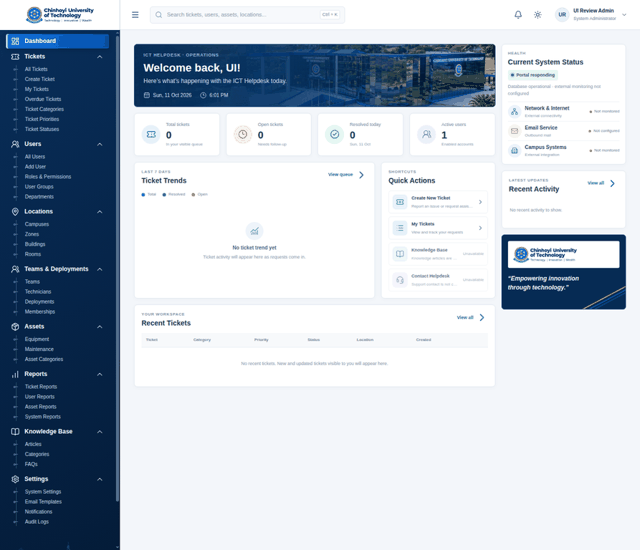

<div align="center">

# CUT ICT Helpdesk

### A secure, role-aware digital front door for Chinhoyi University of Technology ICT support

[](https://laravel.com/)
[](https://www.php.net/)
[](https://vite.dev/)
[](#quality-gates)
[](#quality-gates)
[](#project-boundary)

<p align="center">
  <strong>Request intake · Triage · Technician workflow · Locations · Teams · Analytics · Audit</strong>
</p>

<p align="center">
  
</p>

</div>

> **Important:** This is a locally verified development foundation, not an approved production deployment. CUT ICT still needs to confirm identity, roles, privacy, retention, branding, hosting, database, email, accessibility, and operational policy before live use.

## What is inside

CUT ICT Helpdesk is a Laravel modular monolith with a server-rendered Blade interface. It gives requesters a simple way to report issues and gives authorized support staff a controlled workspace for triage, assignment, workflow history, and aggregate reporting.

| Portal | Coverage |
| --- | --- |
| **Requester support** | Login, ticket creation, own-ticket queue, public replies, explicit reopening |
| **Helpdesk operations** | Global triage queue, manual assignment to an active individual Technician, workflow status changes |
| **Administration** | Users, roles, permissions, groups, departments, campuses, zones, buildings, rooms |
| **Team operations** | Generic teams, effective-dated Technician memberships, date-bounded zone deployments |
| **Asset and knowledge workspaces** | Equipment, maintenance, asset categories, articles, categories, and FAQs as controlled setup-ready portals |
| **Insights and governance** | Aggregate ticket analytics, audit event filters, in-app notifications, system settings workspace |

## UI review gallery

The following captures were taken from the authenticated live preview during the October 2026 UI review. Empty directories are intentional where CUT-specific source data has not been approved or connected.

| Portal | Screenshot | Portal | Screenshot |
| --- | --- | --- | --- |
| Sign in | [Open](docs/screenshots/login.webp) | Dashboard | [Open](docs/screenshots/dashboard.webp) |
| Ticket queue | [Open](docs/screenshots/tickets.webp) | Create ticket | [Open](docs/screenshots/create-ticket.webp) |
| Add user | [Open](docs/screenshots/create-user.webp) | Locations | [Open](docs/screenshots/campuses.webp) |
| Teams | [Open](docs/screenshots/teams.webp) | Equipment | [Open](docs/screenshots/equipment.webp) |
| Knowledge base | [Open](docs/screenshots/knowledge-base.webp) | Ticket categories | [Open](docs/screenshots/ticket-categories.webp) |
| Ticket categories | [Open](docs/screenshots/ticket-categories.webp) | Reports | [Open](docs/screenshots/reports.webp) |
| System settings | [Open](docs/screenshots/settings.webp) | Audit logs | [Open](docs/screenshots/audit.webp) |

See the full [UI review evidence log](docs/UI_REVIEW.md) for routes, review notes, and known refinements.

## Experience principles

- **Consistent workspace language:** the same page header, summary cards, toolbar, data table, empty state, and next-step pattern appears across administration portals.
- **Honest empty states:** the application does not invent CUT departments, locations, categories, assets, teams, or knowledge content.
- **Safe by default:** requester ownership, technician assignment scope, granular permissions, CSRF protection, active-account enforcement, and audit-safe payloads are enforced server-side.
- **Responsive first:** dense tables scroll safely, filters collapse for smaller screens, and forms remain usable on narrow layouts.
- **Progressive configuration:** setup-ready pages show what can be enabled next without pretending that deferred domain workflows are complete.

## Technology

- **Backend:** PHP 8.3+, Laravel 13, Laravel Fortify, Eloquent
- **Frontend:** Blade, Tailwind CSS 4, Vite 8, Lucide icons
- **Data:** SQLite for local development and isolated tests; production SQL is still undecided
- **Quality:** PHPUnit/Pest feature coverage, Laravel Pint, Vite production builds, Composer and npm audits

## Quick start

Use a clean local checkout and keep real credentials and institutional data out of Git:

```sh
unset APP_ENV APP_KEY DB_CONNECTION DB_DATABASE DB_URL
composer install --no-interaction
cp .env.example .env
php artisan key:generate
touch database/database.sqlite
npm ci --ignore-scripts
php artisan migrate --seed
npm run build
php artisan app:create-administrator
php artisan serve --host=127.0.0.1 --port=8000
```

Open `http://127.0.0.1:8000/login`. The administrator bootstrap command prompts for credentials and does not seed a privileged account automatically.

For the complete sequence, demo-ticket data, environment safeguards, and production boundary, read [Setup and Bootstrap](docs/SETUP.md).

## Quality gates

```sh
composer test
./vendor/bin/pint --test
npm run build
composer audit --locked
npm audit --audit-level=moderate
```

Latest UI-review run:

- **71 tests passed**
- **536 assertions passed**
- Blade templates cached successfully
- Vite production build completed successfully
- `git diff --check` passed
- Authenticated browser review completed across dashboard, tickets, forms, locations, teams, assets, knowledge base, reports, settings, and audit

## Documentation map

- [Setup and administrator bootstrap](docs/SETUP.md)
- [Architecture and security boundaries](docs/ARCHITECTURE.md)
- [Domain model](docs/DOMAIN_MODEL.md)
- [Roles and permissions](docs/ROLES_AND_PERMISSIONS.md)
- [Feature roadmap](docs/FEATURE_ROADMAP.md)
- [Requirements and open questions](docs/REQUIREMENTS_AND_OPEN_QUESTIONS.md)
- [Development guidelines](docs/DEVELOPMENT_GUIDELINES.md)
- [Testing strategy](docs/TESTING_STRATEGY.md)
- [UI review evidence](docs/UI_REVIEW.md)
- [Screenshot provenance](docs/SCREENSHOTS.md)
- [Contributing](CONTRIBUTING.md)
- [Security policy](SECURITY.md)
- [Code of conduct](CODE_OF_CONDUCT.md)
- [Changelog](CHANGELOG.md)

## Project boundary

This repository intentionally does **not** claim to implement or approve SSO/LDAP/Active Directory, email delivery, password-reset mail, attachments, SLA timers, automatic routing, team-based ticket authorization, regional ticket segregation, production hosting, asset source-of-truth synchronization, knowledge publishing workflow, or institutional retention policy. Those require explicit CUT ICT decisions and integration ownership.

## License

See [LICENSE](LICENSE). CUT-specific policy, brand, content, and operational approval remain the responsibility of Chinhoyi University of Technology.
