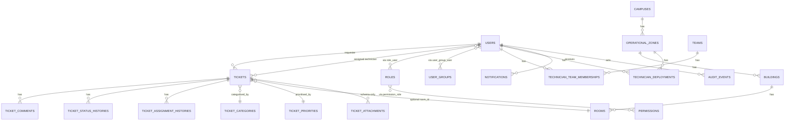

# Database Schema Reference

**Status:** Reference generated from the 22 migration files in `database/migrations/`. Only SQLite has been exercised. "Schema-only" means the table/column exists but has no user-facing workflow wired up yet.

## Entity overview

## Table reference

| Table | Purpose | Notes |
| --- | --- | --- |
| `users` | Accounts | `is_active` added by `...120001`; inactive accounts cannot log in |
| `roles`, `permissions`, `permission_role`, `role_user` | Proposed RBAC catalogue | Seeded; no web editor for the catalogue |
| `user_groups`, `user_group_user` | Administrative grouping of users | Shipped and tested (`UserGroupController`, admin UI) |
| `campuses`, `operational_zones`, `buildings`, `rooms` | Location hierarchy | Guarded create/update; no hard-delete routes |
| `ticket_categories`, `ticket_priorities` | Configurable catalogue | Empty by default; `description` and `priority_color` added later |
| `tickets` | Ticket records | Adds `room_id` and `due_at` (`...000001`) — schema-only, no SLA behaviour |
| `ticket_comments` | Public replies and internal notes | Visibility enforced by policy/permission |
| `ticket_status_histories`, `ticket_assignment_histories` | Workflow history | Transactional records; omit text payloads |
| `ticket_attachments` | Attachment metadata | **Schema-only** — validation exists in `StoreTicketRequest`, no persistence call found |
| `notifications` | Database-only in-app notifications | Generic payloads (ticket ID, event code, generic text) |
| `audit_events` | Administrative audit trail | Application-level update/delete guards; omits secrets and changed text |
| `teams`, `technician_team_memberships`, `technician_deployments` | Phase 3 metadata | Inclusive dates; overlaps governed by migration constraints |
| `cache`, `jobs` | Laravel framework store | Session/cache default to `database` in `.env.example` |

## Migration index

| Order | Migration | Effect |
| --- | --- | --- |
| 1–3 | `0001_01_01_*` | Users, cache, jobs |
| 4 | `...120001_add_is_active_to_users_table` | Active-account enforcement |
| 5 | `...120002_create_roles_and_permissions_tables` | RBAC catalogue |
| 6 | `...120003_create_location_tables` | Campus → zone → building → room |
| 7 | `...120004_create_audit_events_table` | Audit trail |
| 8 | `...125001_create_ticket_catalogues_tables` | Categories and priorities |
| 9 | `...125002_create_tickets_table` | Tickets |
| 10 | `...125003_create_ticket_comments_table` | Comments |
| 11 | `...125004_create_ticket_status_histories_table` | Status history |
| 12 | `...125005_create_ticket_assignment_histories_table` | Assignment history |
| 13 | `...130001_create_teams_table` | Teams |
| 14 | `...130002_create_technician_team_memberships_table` | Memberships |
| 15 | `...130003_create_technician_deployments_table` | Deployments |
| 16 | `...140001_add_created_at_index_to_tickets_table` | Report date-range index |
| 17 | `...140002_allow_duplicate_overlapping_technician_deployments` | Deployment overlap rule |
| 18 | `...150001_create_notifications_table` | Notifications |
| 19 | `...000001_add_room_and_due_date_to_tickets_table` | `room_id`, `due_at` (schema-only) |
| 20 | `...000002_add_descriptions_and_priority_color_to_ticket_catalogues` | Catalogue metadata |
| 21 | `...000003_create_ticket_attachments_table` | Attachment metadata (schema-only) |
| 22 | `...000004_create_user_groups_tables` | User groups |

## Constraints and caveats

- Referenced rows use restrictive foreign keys; there are no hard-delete routes for configuration data.
- Only SQLite migrations have been executed. Run a reviewed rehearsal on the CUT-selected engine before production (see [Deployment](DEPLOYMENT.md)).
- Audit guards are application-level Eloquent hooks; they do not stop bulk SQL or a database administrator.
- Never run `migrate:fresh` or destructive seeders against shared data.

Related: [Domain model](DOMAIN_MODEL.md) · [Architecture](ARCHITECTURE.md) · [Operations runbook](OPERATIONS_RUNBOOK.md)
